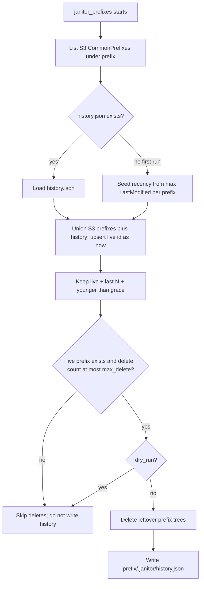
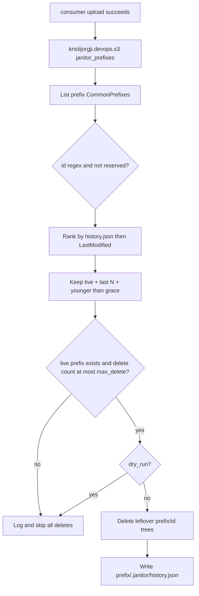

# Role: `kristijorgji.devops.s3`

Keep-last-N janitor for versioned S3 key prefixes (git-SHA folders). HTML routing is the
consumer's problem; this role only lists, keeps, and optionally deletes prefix trees.

---

## Table of contents

- [Task files](#task-files)
- [`janitor_prefixes`](#janitor_prefixes)
  - [history.json bootstrap](#historyjson-bootstrap)
  - [Keep and delete policy](#keep-and-delete-policy)
  - [Variables](#variables)
  - [Safety](#safety)

---

## Task files

| File               | Purpose                                                           |
| ------------------ | ----------------------------------------------------------------- |
| `janitor_prefixes` | List `{prefix}{id}/`, keep live + last N + grace, delete the rest |

When the play uses `--tags`, put matching tags in `apply.tags` on `include_role`.
Requires controller `boto3` on `ansible_playbook_python`. Supply AWS credentials in
the environment (`AWS_ACCESS_KEY_ID` / `AWS_SECRET_ACCESS_KEY`) or optional
`s3_janitor_aws_*` vars; do not pass secrets as extra-vars.

---

## `janitor_prefixes`

Required: `s3_janitor_bucket`, `s3_janitor_prefix`, `s3_janitor_live_id`.
Optional: `s3_janitor_region`, `s3_janitor_keep_releases`, `s3_janitor_grace_days`,
`s3_janitor_max_delete`, `s3_janitor_dry_run`, `s3_janitor_reserved`,
`s3_janitor_id_pattern`, `s3_janitor_history_key`.

Runs on the host selected by consumer `apply.delegate_to` (typically `127.0.0.1`).
Stdout is one JSON object (`keep`, `delete`, `deleted`, `dry_run`, `skipped_reason`,
`history_seeded`). Usage errors exit `2`; AWS/script errors set `skipped_reason=aws_error`
and exit `0` so a consumer deploy is not failed by hygiene.

```yaml
- ansible.builtin.include_role:
    name: kristijorgji.devops.s3
    tasks_from: janitor_prefixes
    apply:
      delegate_to: 127.0.0.1
      become: false
  vars:
    s3_janitor_bucket: my-web-assets
    s3_janitor_prefix: web/
    s3_janitor_live_id: "{{ commitHash }}"
    s3_janitor_keep_releases: 10
    s3_janitor_grace_days: 7
    s3_janitor_dry_run: false
    s3_janitor_aws_access_key_id: "{{ deploy_access_key_id }}"
    s3_janitor_aws_secret_access_key: "{{ deploy_secret_access_key }}"
```

### history.json bootstrap

`history.json` is **not** pre-seeded. It is not in git. After the first successful
mutating run it is stored at `s3://<bucket>/<prefix>.janitor/history.json`
(for example `s3://prona365-web-assets-prod/web/.janitor/history.json`).

`.janitor` is a reserved CommonPrefix (like `shared/`): never treated as a release
id and never deleted. Existing IAM that already allows `prefix*` is enough.

A missing object (first run, 404) is normal. Recency is discovered from S3:

1. List CommonPrefixes under `s3_janitor_prefix` (`shared/` and `.janitor/` ignored).
2. Allowlist names matching `s3_janitor_id_pattern` (default git SHA).
3. For each remaining prefix, recency = max object `LastModified`.
4. Mark `s3_janitor_live_id` as `uploaded_at=now`.
5. Apply keep-last-N + grace + circuit breaker.
6. Write `history.json` only after a successful non-dry-run that did not abort.

If `history.json` is later deleted, the next run re-seeds from `LastModified`.



### Keep and delete policy

Keep set = `{live_id}` plus the newest `s3_janitor_keep_releases` existing prefixes plus
any prefix with `uploaded_at` inside `s3_janitor_grace_days`. Delete set = existing
allowlisted prefixes minus keep. `shared/` and `.janitor/` are never candidates.



### Variables

| Variable                           | Default                         | Description                                                         |
| ---------------------------------- | ------------------------------- | ------------------------------------------------------------------- |
| `s3_janitor_bucket`                | —                               | Target bucket.                                                      |
| `s3_janitor_prefix`                | —                               | Release parent prefix (`web/`). Trailing slash is added if missing. |
| `s3_janitor_live_id`               | —                               | Folder name that must never be deleted (git SHA).                   |
| `s3_janitor_region`                | `eu-central-1`                  | AWS region.                                                         |
| `s3_janitor_keep_releases`         | `10`                            | Newest existing prefixes to keep (includes live).                   |
| `s3_janitor_grace_days`            | `7`                             | Also keep prefixes newer than this many days.                       |
| `s3_janitor_max_delete`            | `20`                            | Circuit breaker; if more candidates, delete nothing.                |
| `s3_janitor_dry_run`               | `false`                         | List keep/delete only; do not write history.                        |
| `s3_janitor_reserved`              | `shared`, `.janitor`            | CommonPrefix names that are never release ids.                      |
| `s3_janitor_id_pattern`            | `(?i)^[0-9a-f]{7,40}$`          | Allowed release folder names.                                       |
| `s3_janitor_history_key`           | `{prefix}.janitor/history.json` | Must stay under `{prefix}.janitor/`.                                |
| `s3_janitor_aws_access_key_id`     | omit / env                      | Optional; otherwise use `AWS_ACCESS_KEY_ID` in the environment.     |
| `s3_janitor_aws_secret_access_key` | omit / env                      | Optional; otherwise use `AWS_SECRET_ACCESS_KEY` in the environment. |

### Safety

- Live prefix missing on S3 → `skipped_reason=live_prefix_missing`, no deletes.
- `len(delete) > s3_janitor_max_delete` → `skipped_reason=circuit_breaker`, no deletes.
- Keys must start with `{prefix}{allowlisted_id}/`. `shared/`, `.janitor/`, and the
  bucket root are refused.
- AWS/script errors → `skipped_reason=aws_error`, exit `0`.
- Dry-run never writes `history.json` and never deletes.
